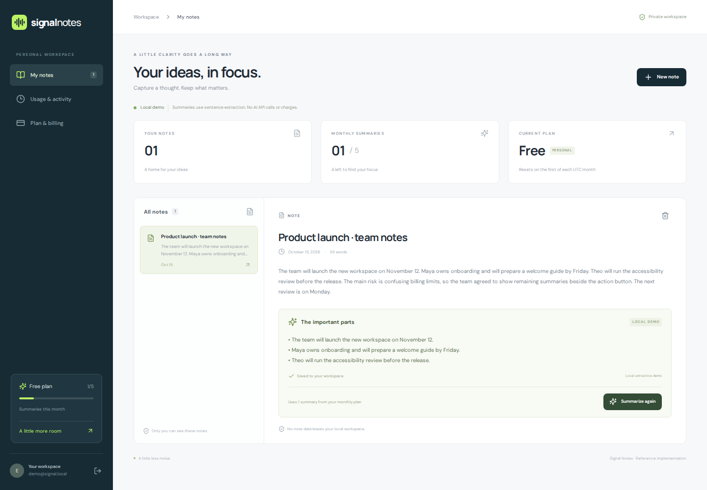
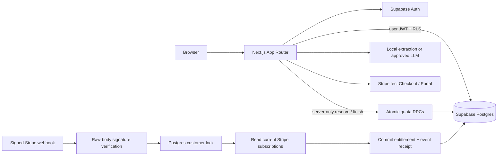

# Signal Notes

[](https://github.com/IgorFedchenko/signal-notes-ai-saas/actions/workflows/ci.yml)

**A reference implementation of an AI SaaS: private notes, useful summaries, and predictable subscriptions.**

For clients who need to ship a subscription product without leaving authentication,
tenant isolation, billing retries, and AI limits as unfinished work. Built with
**Next.js App Router, TypeScript, Supabase Auth + Postgres, and Stripe test billing**.
MIT licensed. All demo content is synthetic; no employer or client code, names, or data.



[Landing page](docs/screenshots/landing.png) · [Mobile workspace](docs/screenshots/mobile.png) · [Verification record](docs/VERIFICATION.md)

## Try it locally

Prerequisites: Node.js 22–26, npm, and a running Docker engine. From a fresh clone:

```sh
npm run demo
```

This installs pinned dependencies, starts this project's isolated Supabase stack,
applies migrations, seeds a demo account and note, and starts Next.js at
**http://127.0.0.1:3210**. The initial Docker image download can take a few minutes.
Sign in as `demo@signal.local` with password `SignalNotes-Demo-2026!`, or create
your own local account. These are disposable local credentials, never hosted credentials.

The default **local extractive demo** selects the first three sentences. It does
not call an LLM, consume API credits, or pretend to be a model response. The same
reservation and persistence path is used by the optional real LLM adapter.
Stripe checkout is visibly unavailable until test credentials are configured.

On Igor's Studio host, run the entry point through the shared heavy-job queue:

```sh
~/.local/bin/studio-heavy-run -- npm run demo
```

Stop the app with Ctrl+C. Stop its Docker stack with `npm run local:stop`
(also through the wrapper on Studio). Supabase ports: API `56321`, Postgres `56322`,
local mail inbox `56324`. Other local stacks are not modified. The launcher refuses
to overwrite an owner-managed `.env.local`.

## What works

- Email/password signup, login, logout, server-validated identity and cookie refresh.
- Create, read and delete private plain-text notes; read persisted summary history.
- Atomic per-user quotas: Free **5**, Pro **100** summaries per UTC calendar month.
- Durable request keys, concurrent reservation limits, failure recovery and actual
  provider-reported input/output token counts (zero for local extraction).
- Stripe test Checkout, hosted customer portal, signed webhooks and transactional
  subscription reconciliation. Repeated checkout clicks reuse an open session.
- Responsive desktop and mobile UI, with explicit unavailable/error/limit states.

## Architecture



`src/app` contains pages and HTTP boundaries. `src/lib` contains auth, AI, metering
orchestration and billing. The migration under `supabase/migrations` defines the
schema, permissions and transactional quota functions. No separate backend or
background worker is required for these bounded synchronous requests.

## Reliability and security

**Tenant isolation.** Note operations use the current user's JWT, never a service
key. Every exposed table has RLS. Users can only read their billing and usage rows;
they cannot write entitlements, token counts or webhook receipts. RLS tests sign
in as two real Supabase Auth users and attempt foreign reads/deletes, forged owners,
ownership transfers, billing escalation and direct metering RPC calls.

**Secrets.** Service-role access is confined to `server-only` modules and metering
RPCs after authentication and note ownership checks. Stripe and database credentials
also remain server-only. CI scans browser build assets for configured server secrets.
The only public Supabase values are its URL and publishable/anon key; RLS is required.

**AI usage.** A database advisory lock serializes each user's reservation check.
The reservation counts toward quota before generation starts. A successful result
is persisted before returning; retrying the same request returns the saved result.
Failure releases the slot; a crashed reservation expires after two minutes.
Expired/failed request keys cannot be reused by a late worker. The provider timeout
is 25 seconds; input is limited to 12,000 characters and output to 400 model tokens.
No automatic provider retries: a timed-out request may already have cost tokens.
User instructions inside notes are untrusted data; the model has no tools.

**Billing.** Only `sk_test_` keys and non-live webhook events are accepted. The
raw body is verified with Stripe's SDK and timestamp tolerance. Checkout binds a
customer to the authenticated account, locks that account, reuses open sessions,
and refuses another subscription when one already exists. The server chooses the
price and return URLs. Redirect parameters never grant Pro access.

**Webhooks.** Processing holds a Postgres transaction lock per customer while
reading current Stripe state, then commits entitlements and the unique event ID
together. Duplicate delivery exits without another update or Stripe read. Older
events still read current Stripe state, so their old payload cannot roll billing
back. Errors roll back the receipt and return a retryable non-2xx response. No raw
webhook/card payloads are stored. Unknown customers are acknowledged and ignored.
Past-due/canceled/expired subscriptions have Free access; period-end cancellation
keeps Pro until the current paid period ends.

**HTTP boundaries.** State-changing browser routes require an exact configured
Origin and revalidate the user. JSON bodies are bounded and schema-validated.
Notes and summaries are plain text rendered with React escaping. Sensitive API
errors are sanitized; logs exclude note content, credentials and provider payloads.
Authenticated responses are private and not cached. See [deployment notes](docs/DEPLOYMENT.md).

## Stripe test setup

The owner supplies test credentials locally in an ignored `.env.local`; never send
them in chat or commit them. Start from [.env.example](.env.example).

1. Create a recurring **monthly USD 12** test price in Stripe. Set
   `STRIPE_SECRET_KEY`, `STRIPE_PRO_PRICE_ID`, and `STRIPE_WEBHOOK_SECRET`.
2. Enable the Stripe customer portal with cancellation and payment-method management.
   Do not enable unrelated prices or arbitrary subscription switches.
3. Supply `SUPABASE_DB_URL` (local DSN or hosted Supabase transaction pooler DSN).
   The webhook uses a real Postgres transaction; prepared statements are disabled
   for transaction pooling. Hosted connections verify TLS certificates.
4. For local test events, run Stripe CLI forwarding:

   ```sh
   stripe listen --forward-to http://127.0.0.1:3210/api/stripe/webhook \
     --events checkout.session.completed,customer.subscription.created,customer.subscription.updated,customer.subscription.deleted
   ```

5. Restart Next.js, sign in, open **Plan & billing**, and select **Try Pro in test mode**.
   Use Stripe's [test payment details](https://docs.stripe.com/testing), then refresh
   the plan after delivery. Verify cancellation in the portal and replay the same event.

The synthetic test suite verifies signatures and real database effects without a
Stripe account. It does **not** claim an actual Stripe-hosted payment was completed.
That roundtrip requires the owner's test account.

## Optional real LLM

Only after the owner approves the API key and its use, set `AI_PROVIDER=openai`,
`OPENAI_API_KEY` and `OPENAI_MODEL` in the server environment. Restart Next.js.
Notes are then sent to that configured provider. Tests mock recorded response
shapes and never use a real API key. Set provider-side spending limits before a
public demo. The repository itself does not provision a key or approve spending.

## Verification

```sh
npm run check           # ESLint, TypeScript, unit tests
npm run local:setup     # dedicated Supabase, migrations and synthetic seed
npm run test:db         # real Auth/RLS + concurrent quota/billing tests
npm run build
node --env-file=.env.local scripts/check-client-secrets.mjs
npx playwright install chromium
npm run test:e2e        # production build, desktop + mobile Chromium
```

On Studio, builds, Docker setup and browser tests use `studio-heavy-run`. GitHub
Actions runs these on a standard Ubuntu runner, using local Supabase and mocked
external responses. No hosted credentials or paid model calls are needed. Browser
tests assert persisted database state and save screenshots as a CI artifact.

## Scope and limits

- This is a reference implementation, not an operated production service. Repository
  publication awaits owner review. A hosted demo requires owner-provided access.
- Notes are immutable after creation; create a new note to revise content. The UI
  lists the latest 100 notes and 200 generation records. Monthly usage is queried
  separately, so history truncation cannot hide consumed quota.
- Summary quota uses UTC calendar months, independently of the Stripe invoice date.
  Upgrades increase the current month's cap; they do not erase consumption.
- Exactly-once model execution across a process crash is impossible without provider
  support. A crash after provider completion but before persistence may require a new
  call. Usage records contain actual tokens only for successfully persisted results;
  they are not a substitute for the provider's financial ledger.
- Billing intentionally refuses ambiguous multiple active Pro subscriptions and more
  than 100 subscriptions per customer. Such accounts require operator review.
- No paid operation, live Stripe key, scheduler, file upload, organization sharing,
  document search, or production-grade abuse prevention is included. Before opening
  public signup, configure email confirmation/SMTP, CAPTCHA, rate limiting, retention,
  monitoring and provider spend controls. No real personal data belongs in this demo.
- Free hosting has usage limits. [Vercel Hobby](https://vercel.com/docs/plans/hobby)
  is restricted to non-commercial personal use; confirm this demo fits before deploying.

Built by Igor Fedchenko. See [portfolio copy](docs/PORTFOLIO.md) and [delivery criteria](docs/PLAN.md).
