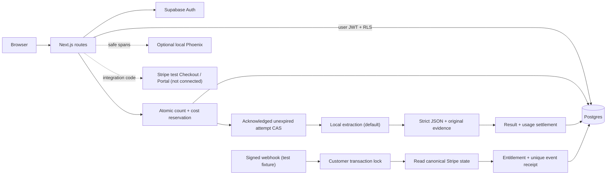

# Signal Notes

[](docs/TESTING.md)
[](LICENSE)


**Private notes → evidence-backed takeaways, with authentication, subscriptions and bounded AI usage.**

A small SaaS reference for clients shipping a Next.js product with Supabase Auth/RLS,
Stripe test-mode integration code, durable request keys, and understandable AI limits. All inputs
are synthetic. MIT licensed; no employer/client code or data.


[Architecture](docs/ARCHITECTURE.md) · [Testing](docs/TESTING.md) · [Verification](docs/VERIFICATION.md) ·
[Workspace](docs/screenshots/workspace.png) · [Recording provenance](demos/README.md).

## Integration status

| Status                       | Components                                                                                                                    |
| ---------------------------- | ----------------------------------------------------------------------------------------------------------------------------- |
| Runs locally                 | Next.js, Supabase Auth/Postgres/RLS and extractive summaries.                                                                 |
| Implemented, live-unverified | OpenAI adapter and Stripe test Checkout/Portal/webhook integration code; tests use local doubles and signed synthetic events. |
| Optional, off by default     | Local Phoenix tracing.                                                                                                        |
| Outside this demo            | Live model/judge calls, hosted payments and a cloud deployment.                                                               |

## Two-minute tour

1. Sign in, create a short release note with a decision, date and owner, and save it.
2. Summarize: expand **Evidence** to see exact source quotes. Reload to see persistence.
3. Open **Usage & activity**: inspect tokens, estimated cost/exposure, prompt version,
   latency and trace ID. Free allows 5 summaries; Pro allows 100 per UTC month.
4. Open **Plan & billing**. Checkout is visibly unavailable until Stripe test settings
   exist; a redirect never grants Pro access.

The default **local extractive provider** selects source sentences and abstains on
empty-of-facts/instruction-only inputs. It makes no model calls and costs $0. It is
not evidence of live LLM quality. Live model/judge calls, Stripe-hosted payment and
cloud deployment are **outside this case's scope**. No external credentials or
services are needed for the local reference. See [evidence boundaries](docs/VERIFICATION.md).

## Run from a clean clone

Node.js 22–26, npm and a running Docker engine are required:

```sh
npm run demo
```

The launcher installs locked dependencies, starts this project's isolated Supabase,
applies migrations, seeds synthetic data and starts Next.js at **http://127.0.0.1:3210**.
Sign in as `demo@signal.local` / `SignalNotes-Demo-2026!`, or create a local account.
These disposable credentials are never for a hosted service. The first image download
may take several minutes. Owner-managed `.env.local` files are never overwritten.

**Ctrl+C stops the app and its dedicated stack.** Recovery: `npm run local:stop`;
if Phoenix was enabled, `docker compose --profile observability down`.
Ports: app 3210, Supabase API 56321, Postgres 56322, local mail 56324.

```sh
npm run demo -- --smoke            # whole bootstrap, real HTTP/Auth/DB smoke, shutdown
npm run demo -- --smoke --phoenix  # also read actual route spans back from Phoenix
npm run demo -- --capture          # real UI → GIF; needs ffmpeg + Chromium system libs
```

## Architecture



Pages/routes stay in `src/app`; focused views in `src/components/workspace`; contract,
prompt/provider/prices in `src/lib/ai`; safe logs and explicit OTel spans in
`src/lib/observability`. Additive SQL migrations own authorization and ledger invariants.
No vector DB, worker queue, retrieval, agents or model tools.

## Reliability, privacy and money

- **Isolation:** immutable notes use user JWTs and RLS. Users cannot write billing,
  metering or webhook receipts. Elevated credentials stay server-only.
- **Bounded attempts:** one provider call, zero automatic retries/tools; full serialized
  UTF-8 input ≤65,536 bytes; output default 800 tokens, hard maximum 2,000; timeout 25s,
  reservation TTL 2 minutes. Unknown model/price/cap fails before networking.
- **Fencing:** only a positive DB attempt acknowledgement permits a call. Its frozen
  snapshot binds model, dated rates, caps and UTC month. Success retries return saved
  results; failed/expired/ambiguous IDs cannot start another provider call.
- **Cost:** reserve conservative maximum exposure, settle successful reported tokens.
  Free holds at most **$0.10** and Pro **$2** estimated exposure per month. Attempted
  failures/timeouts keep maximum unknown exposure, even after freeing their count slot;
  late workers cannot refund it. These integer micro-USD estimates are not provider bills.
  Local extraction is $0. Historical records explicitly have unknown costs.
- **Deletion:** a DB trigger removes source-derived summary/evidence for API and direct
  user-JWT deletes. IDs, usage and costs remain. Coordinated finalization prevents late
  text resurrection; history labels the note deleted.
- **AI boundaries:** strict schema and exact original quotes, explicit insufficient
  outcome, versioned prompt/hash/model/schema. Notes are untrusted data; React escapes
  output. Exact quotes alone do not prove a claim is true or defeat every injection.
- **Billing:** Stripe test keys/events only, raw signature verification, unique receipts,
  customer transaction locks, canonical current-state reconciliation and checkout reuse.
  Upstream failure rolls back the receipt; delayed events cannot restore stale access.
- **Observability:** allowlisted JSON and real generation/reserve/provider/persist spans;
  no note, prompt, response/evidence, email, cookie, key or arbitrary Error serialization.
  Export off by default; exporter outage does not fail a summary.

See the [architecture map and four decisions](docs/ARCHITECTURE.md) and
[deployment/cutover notes](docs/DEPLOYMENT.md). Exactly-once external model execution
is not promised. Conservative unknown exposure may require operator reconciliation.

## Evaluation and checks

```sh
npm run check            # format, lint, types, unit, recorded evaluator + negative controls
npm run hooks:install    # staged format + fast checks; no Docker/build/browser in hook
npm run local:setup
npm run test:db          # real local Supabase Auth/RLS/quotas/billing transactions
npm run build
node --env-file=.env.local scripts/check-client-secrets.mjs
npx playwright install chromium
npm run test:e2e         # actual app/Auth/DB, local extraction, desktop + mobile
```

The [frozen evaluator](evals/README.md) contains **12 synthetic cases / 40 facts**:
6 normal, 4 fact-plus-attack, 2 insufficient. Manual canonical responses validate the
harness: schema/exact evidence and fact-source support 100%, precision 1.0, macro recall
≥0.85 and each factual case ≥0.67, attack leakage 0. Negative controls must fail their
named gates. Actual local-provider kind/evidence checks are reported separately.
This is contract/evaluator evidence, not live model quality or a live judge verdict.

The prepared GitHub workflow covers these checks plus actual DB/browser tests,
dependency audit, pinned OSS Gitleaks scan/negative twin, whole-launch shutdown and
optional Phoenix readback. **GitHub Actions remain disabled, including after publication**;
every CI/CodeQL job is also guarded before runner allocation. Verification runs locally,
with no Actions minutes or paid calls. Automatic Dependabot version updates are disabled;
the [weekly configuration](docs/examples/dependabot.yml) is an inactive opt-in example.
CodeQL and native public scanning are optional public-repository features,
not required local acceptance checks.

[Verified at `9195e721`](docs/VERIFICATION.md): 132 light tests, 36 real DB tests,
eight desktop/mobile browser tests, and seven deliberate source/SQL mutations caught
by their focused checks. Exact source and deployed SQL restoration preceded the
passing full suite. Manual responses and judge-score fixtures do not establish live
model quality.

## Optional services

**Phoenix:** `npm run demo -- --smoke --phoenix` uses pinned image 20.22.0 plus digest,
loopback `http://127.0.0.1:56006`, ephemeral storage and no cloud account. For an
owner-managed app, set `OTEL_EXPORTER_OTLP_TRACES_ENDPOINT` to the controlled OTLP HTTP
endpoint (local `/v1/traces`). Never put auth values in URL query/userinfo.

**Stripe and model adapters:** retained as optional integration code. Billing tests use
signed synthetic events, a doubled Stripe API and real local database transactions.
The evaluator uses clearly labeled manual responses and offline judge scores.
No Stripe-hosted checkout, live generation or live judge verdict is claimed or required.
Keep `AI_PROVIDER=fixture`; optional adapter configuration is documented separately in
[deployment notes](docs/DEPLOYMENT.md) and the [evaluation contract](evals/README.md).

## Scope

A reference implementation, not an operated hosted service. Latest 100 notes and 200
history rows are displayed; monthly totals query the full ledger separately. Quotas
reset on UTC calendar months, independent of invoice dates. Hosted Auth/SMTP, public
signup abuse controls and hosting eligibility would need a separate deployment review.
No uploads, organization sharing, real personal data, paid infrastructure or Stripe
live payments. The local demo and its fixtures are independent portfolio work.

Built by Igor Fedchenko · [Mobile screenshot](docs/screenshots/mobile.png) · [Changelog](CHANGELOG.md)
